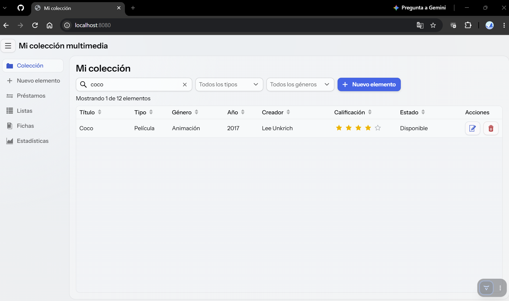
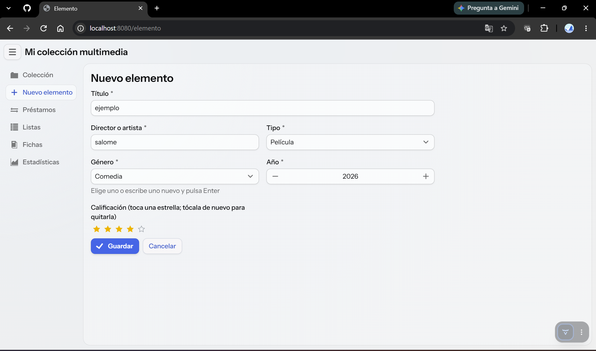
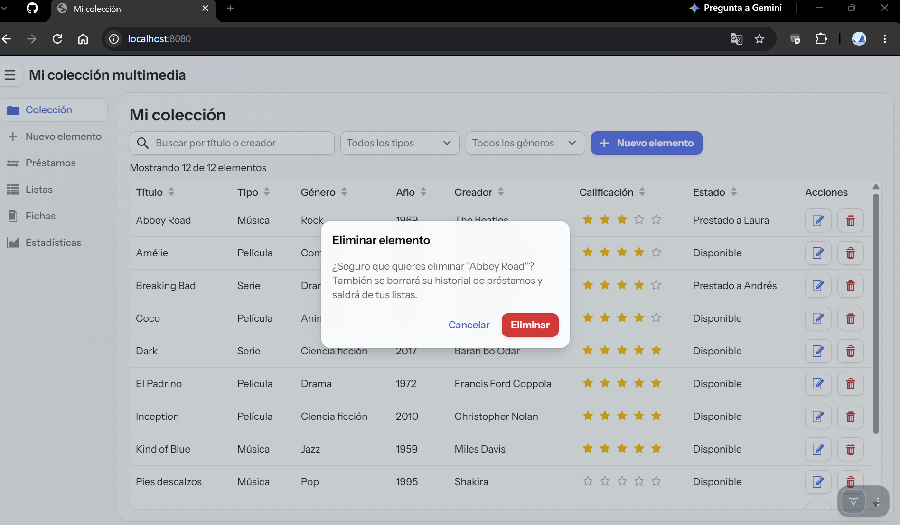
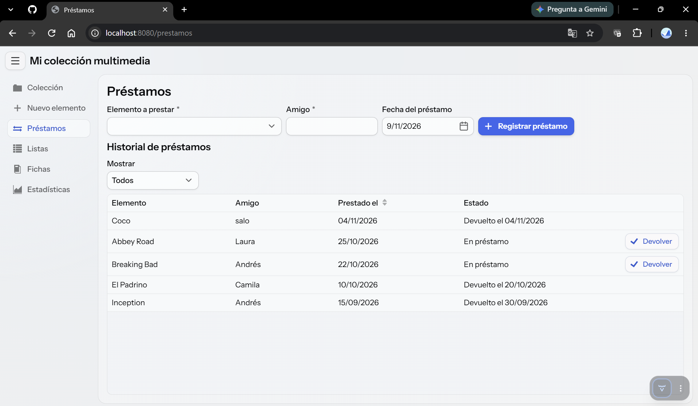
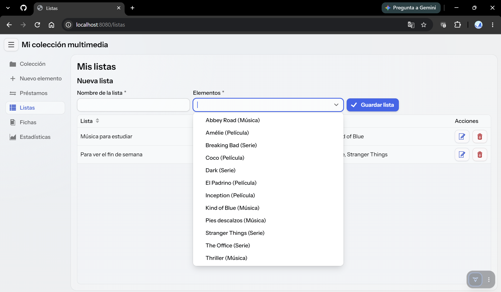
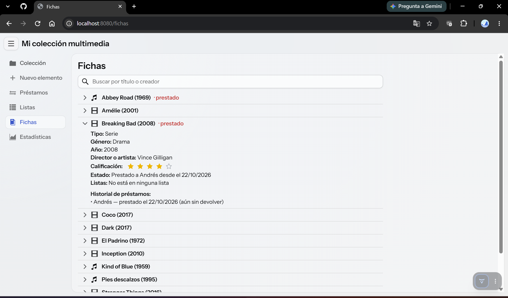
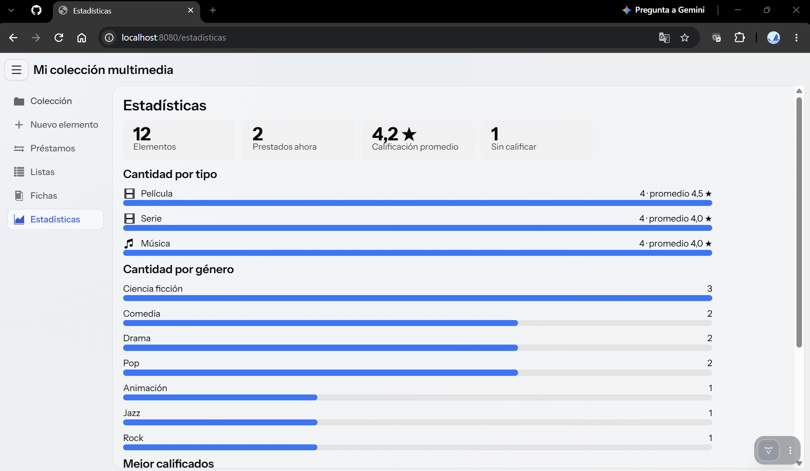

# Colección multimedia

Aplicación web hecha con Vaadin para organizar una colección de películas, series y música: calificarla con estrellas, llevar el control de lo que se presta a los amigos y armar listas personalizadas.

Proyecto final de Lógica de Programación (Proyecto 9).

- **Autor:** Salome Pareja


## Qué hace la aplicación

- **Colección:** tabla con todos los elementos, búsqueda en tiempo real por título o creador, filtros por tipo y género, y orden por columnas.
- **Agregar y modificar:** formulario con validaciones (campos obligatorios, año entre 1850 y el año siguiente, sin elementos repetidos).
- **Eliminar:** pide confirmación. Un elemento que está prestado no se puede eliminar.
- **Calificación con estrellas:** un componente propio (`CalificacionEstrellas`) con 5 íconos clickeables, usado en el formulario y en la tabla, donde la calificación se guarda al tocar una estrella.
- **Préstamos:** se registra a quién se le presta un elemento y en qué fecha, y se registra la devolución. Un elemento ya prestado no se puede volver a prestar. El historial se puede filtrar por estado.
- **Listas personalizadas:** por ejemplo "Para ver el fin de semana". Se agregan varios elementos de una sola vez con un `MultiSelectComboBox`.
- **Fichas:** cada elemento se despliega con un `Details` y muestra sus datos, su estado de préstamo, su historial y las listas donde aparece.
- **Estadísticas:** cantidad por tipo y por género, calificación promedio y los 5 mejor calificados.

### Componentes investigados

| Componente | Dónde se usa |
|---|---|
| `Icon` | Las estrellas de la calificación (`CalificacionEstrellas`) |
| `MultiSelectComboBox` | Vista de listas, para elegir varios elementos a la vez |
| `Details` | Vista de fichas, la ficha desplegable de cada elemento |

## Tecnologías

- Java 21
- Vaadin 
- Spring Boot
- Maven
- Archivos de texto `.txt` para guardar los datos (sin base de datos)

## Cómo ejecutarla

1. Tener instalado Java 21.
2. Clonar el repositorio y abrir la carpeta en VS Code.
3. Ejecutar `ColeccionApplication.java`, o en la terminal:
   - Windows: `mvnw.cmd spring-boot:run`
   - Linux o macOS: `./mvnw spring-boot:run`
4. Abrir <http://localhost:8080> en el navegador. La primera vez tarda un poco más porque Vaadin prepara los recursos.

**En el celular:** con el computador y el celular en la misma red Wi-Fi, abrir `http://IP-DEL-COMPUTADOR:8080` en el navegador del celular. El menú se esconde detrás del botón de hamburguesa y los formularios pasan a una columna.

## Estructura del proyecto

```
src/main/java/co/edu/coleccion/
├── modelo/
│   ├── Elemento.java             película, serie o música
│   ├── Prestamo.java             préstamo de un elemento a un amigo
│   └── Lista.java                lista personalizada
├── datos/
│   └── Almacen.java              lee y escribe los archivos .txt
└── vistas/
    ├── MainLayout.java           barra superior y menú lateral
    ├── ColeccionView.java        tabla principal
    ├── ElementoFormView.java     formulario de agregar y modificar
    ├── PrestamosView.java        préstamos y devoluciones
    ├── ListasView.java           listas personalizadas
    ├── FichasView.java           fichas desplegables
    ├── EstadisticasView.java     estadísticas
    ├── CalificacionEstrellas.java  componente propio de 5 estrellas
    ├── Avisos.java               notificaciones y diálogo de confirmación
    └── Util.java                 formato de fechas e íconos por tipo
```

## Datos

Los datos se guardan en la carpeta `datos/`, un archivo por tipo, con los campos separados por `|`:

| Archivo | Formato de cada línea |
|---|---|
| `elementos.txt` | `id\|título\|tipo\|género\|año\|creador\|calificación` (calificación 0 = sin calificar) |
| `prestamos.txt` | `id\|idElemento\|amigo\|fechaPréstamo\|fechaDevolución` (fecha vacía = aún prestado) |
| `listas.txt` | `id\|nombre\|id1,id2,id3` |

**Datos de ejemplo:** la primera vez que se ejecuta, si no existe la carpeta `datos/`, la aplicación la crea con 12 elementos, 4 préstamos y 2 listas, para poder probar todo sin llenar nada a mano. Para volver a empezar basta con borrar la carpeta `datos/`.

**Errores:** si falta un archivo se trata como vacío, y si una línea está mal escrita se ignora y se avisa por consola, sin que la aplicación se caiga. Antes de guardar se validan los datos y cada cambio se escribe de inmediato, así que todo sigue ahí al reiniciar.

## Manual de uso

### 1. Ver y buscar en la colección
Al abrir la aplicación aparece la tabla. Escribe en el buscador para filtrar mientras escribes, elige un tipo o un género en los filtros, y haz clic en el título de una columna para ordenar.



### 2. Agregar o modificar un elemento
Pulsa **Nuevo elemento**, llena el formulario, toca las estrellas y pulsa **Guardar**. Si falta algo, un mensaje rojo dice qué. Con el lápiz de la tabla se modifica un elemento.



### 3. Calificar y eliminar
En la tabla, toca una estrella para calificar y tócala otra vez para quitar la calificación. La papelera elimina el elemento después de pedir confirmación.



### 4. Prestar y devolver
En **Préstamos** elige el elemento (solo salen los disponibles), escribe el amigo y la fecha, y pulsa **Registrar préstamo**. Para devolverlo, pulsa **Devolver** en su fila y confirma.



### 5. Crear una lista
En **Listas** escribe un nombre, elige varios elementos a la vez y pulsa **Guardar lista**.



### 6. Ver una ficha
En **Fichas** toca un elemento para desplegar todos sus datos y su historial de préstamos.



### 7. Ver las estadísticas
En **Estadísticas** se ven la cantidad por tipo y por género, el promedio y los mejor calificados.

